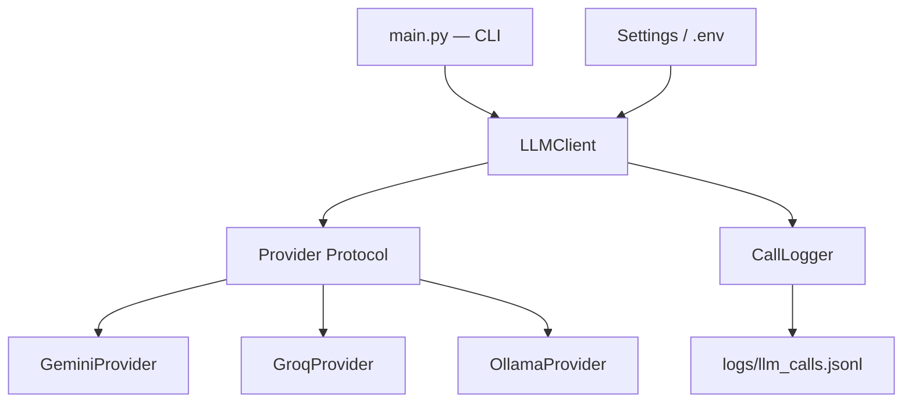

# Agente Operador — Bootcamp AI Engineer

Implementación personal del proyecto integrador del **Bootcamp AI Engineer con Python — 2ª Edición: Agentes de IA en Producción**, impartido por [Código Facilito](https://codigofacilito.com/).

Este repositorio es un fork del proyecto original desarrollado por [Ramses Camas](https://github.com/RamsesCamas/Bootcamp_AI_Engineer_Codigofacilito_2nd_Gen).

El objetivo de esta implementación es desarrollar progresivamente las actividades del bootcamp, aplicando buenas prácticas de ingeniería de software, automatización, calidad de código y control de versiones.

> **Nota:** Esta es una implementación personal e independiente. Las soluciones de las actividades pueden diferir de las propuestas por el instructor.

## Sobre el proyecto

**Agente Operador** es un asistente de inteligencia artificial diseñado para apoyar al equipo de operaciones de una empresa.

El sistema evoluciona progresivamente durante el bootcamp, incorporando capacidades para:

- Interactuar con diferentes proveedores de modelos de lenguaje (LLMs).
- Procesar, resumir y clasificar tickets operativos.
- Gestionar prompts y contexto.
- Ejecutar herramientas y acciones.
- Consultar información mediante RAG.
- Implementar mecanismos de evaluación, observabilidad y control de costos.

### Contenido del bootcamp

| Bloque | Clases | Contenido |
|---|---|---|
| Fundamentos | 1–3 | Cliente LLM multi-proveedor, prompting, contexto y salidas estructuradas |
| Agentes | 4–5 | Agentes con herramientas |
| Conocimiento | 6–9 | RAG y memoria |
| Orquestación | 10–11 | Flujos de múltiples pasos y coordinación de agentes |
| Evaluación | 12–13 | Evaluación y métricas de calidad |
| Producción | 14–17 | Streaming, observabilidad, costos y despliegue |

## Entorno de desarrollo

Esta implementación incorpora un entorno reproducible basado en **Docker y Visual Studio Code Dev Containers**, con el objetivo de mantener aisladas las dependencias y herramientas del proyecto.

### Tecnologías y herramientas

| Herramienta | Propósito |
|---|---|
| Python 3.11 | Lenguaje y versión base del entorno |
| Docker | Aislamiento del entorno de desarrollo |
| Dev Containers | Integración del entorno Docker con VS Code |
| uv | Gestión de dependencias y entornos virtuales |
| Just | Automatización de comandos de desarrollo |
| Ruff | Linting y formateo |
| Pytest | Pruebas automatizadas |
| pre-commit | Validaciones previas a los commits |
| GitHub Actions | Integración continua |

### Requisitos

Para trabajar utilizando el Dev Container necesitas:

- [Docker](https://docs.docker.com/get-docker/)
- [Visual Studio Code](https://code.visualstudio.com/)
- [Dev Containers Extension](https://marketplace.visualstudio.com/items?itemName=ms-vscode-remote.remote-containers)

No es necesario instalar Python ni las dependencias del proyecto directamente en el sistema anfitrión.

### Instalación con Dev Containers

**1. Clonar el repositorio**

```bash
git clone https://github.com/Yenniferh/Bootcamp_AI_Engineer_Codigofacilito_2nd_Gen.git

cd Bootcamp_AI_Engineer_Codigofacilito_2nd_Gen
```

**2. Abrir el proyecto en VS Code**

```bash
code .
```

**3. Iniciar el Dev Container**

Desde la paleta de comandos de VS Code (`Ctrl+Shift+P`), ejecutar:

```text
Dev Containers: Reopen in Container
```

VS Code construirá el contenedor utilizando la configuración de `.devcontainer/`.

Durante la creación del contenedor se ejecuta automáticamente:

```bash
just setup
```

Esta receta sincroniza las dependencias del proyecto mediante `uv` e instala los hooks de pre-commit.

### Permisos del entorno

El Dev Container utiliza un usuario no privilegiado (`vscode`) en lugar de ejecutar las herramientas como `root`.

En Ubuntu, el UID/GID del usuario del contenedor se ajusta para coincidir con el usuario del sistema anfitrión.

Esto permite crear y modificar archivos desde ambos entornos sin generar conflictos de propiedad.

Las herramientas de desarrollo, incluyendo `uv`, `just` y Git, pueden utilizarse directamente desde el contenedor sin privilegios administrativos.

### Instalación sin Dev Container

Como alternativa, puedes trabajar directamente en tu sistema si tienes instalados:

- Python 3.11 o superior
- uv
- just

Ejecuta:

```bash
just setup
```

## Variables de entorno

Crea tu archivo de configuración local a partir del ejemplo:

```bash
cp .env.example .env
```

Configura las API keys correspondientes a los proveedores que utilizarás.

| Variable | Proveedor |
|---|---|
| `GEMINI_API_KEY` | [Google AI Studio](https://aistudio.google.com/apikey) |
| `GROQ_API_KEY` | [Groq Console](https://console.groq.com/keys) |

El proyecto también contempla el uso de [Ollama](https://ollama.com/), que permite ejecutar modelos localmente sin API key.

Si Ollama se ejecuta fuera del Dev Container, puede ser necesario ajustar su dirección de conexión.

> **Seguridad:** Nunca incluyas credenciales ni archivos `.env` en commits. El archivo `.env` está excluido mediante `.gitignore`.

## Automatización con Just

El proyecto utiliza un `Justfile` para centralizar los comandos habituales de desarrollo.

Para consultar todas las recetas disponibles:

```bash
just --list
```

### Comandos disponibles

| Comando | Descripción |
|---|---|
| `just setup` | Sincroniza dependencias mediante `uv` e instala los hooks de pre-commit. |
| `just run` | Ejecuta la aplicación. Admite argumentos adicionales. |
| `just lint` | Analiza el código con Ruff sin modificar archivos. |
| `just lint-fix` | Corrige automáticamente los problemas de linting que Ruff pueda solucionar. |
| `just format` | Aplica el formato de Ruff al código Python. |
| `just format-check` | Verifica el formato sin modificar archivos. |
| `just test` | Ejecuta las pruebas automatizadas con Pytest. |
| `just check` | Ejecuta linting, comprobación de formato y pruebas sin modificar archivos. |
| `just check-dev` | Aplica correcciones automáticas, formatea el código y ejecuta todas las verificaciones. |
| `just hooks` | Ejecuta todos los hooks de pre-commit sobre el repositorio. |
| `just sync-upstream` | Sincroniza `main` con `upstream/main` y publica los cambios en `origin`. |

### Ejemplos de ejecución

Ejecutar la aplicación:

```bash
just run --demo
```

Ejecutar con un proveedor específico:

```bash
just run --provider ollama "Hola"
```

### Workflows de calidad

El proyecto dispone de dos comandos principales para validar el código, según el entorno.

#### Desarrollo local

```bash
just check-dev
```

Ejecuta las siguientes operaciones en orden:

1. `just lint-fix`: corrige automáticamente los errores de linting compatibles con Ruff.
2. `just format`: aplica el formato del código.
3. `just check`: verifica linting, formato y ejecuta las pruebas.

Este comando puede modificar archivos del proyecto. Se recomienda revisar los cambios con `git diff` antes de crear un commit.

#### Integración continua (CI)

```bash
just check
```

Ejecuta las siguientes verificaciones sin modificar archivos:

1. `just lint`: análisis estático con Ruff.
2. `just format-check`: validación del formato.
3. `just test`: ejecución de pruebas con Pytest.

Este comando también es utilizado por GitHub Actions para validar los Pull Requests dirigidos a `develop`.

Las correcciones automáticas no garantizan que todos los problemas puedan resolverse sin intervención manual.

## Calidad de código

Esta implementación incorpora herramientas para mantener la consistencia y calidad del código.

### Ruff

Ruff se utiliza para el análisis estático y el formateo del código Python.

Para comprobar el código sin realizar modificaciones:

```bash
just lint
just format-check
```

Para aplicar correcciones automáticas:

```bash
just lint-fix
just format
```

### Pytest

Las pruebas automatizadas se ejecutan mediante:

```bash
just test
```

Las pruebas unitarias deben poder ejecutarse sin depender de credenciales ni de llamadas reales a servicios externos.

### Pre-commit

Se utilizan hooks para ejecutar verificaciones antes de registrar un commit.

Los hooks configurados incluyen:

- Ruff lint.
- Ruff format check.
- Detección de espacios en blanco problemáticos.

Para ejecutar manualmente todos los hooks:

```bash
just hooks
```

### GitHub Actions

El repositorio incorpora un workflow de integración continua definido en:

```text
.github/workflows/ci.yml
```

Este workflow se ejecuta al crear o actualizar un Pull Request dirigido a `develop`.

Las verificaciones incluyen:

1. Instalación de dependencias.
2. Análisis estático con Ruff.
3. Comprobación de formato.
4. Ejecución de pruebas automatizadas.

El workflow utiliza:

```bash
just check
```

De esta manera, las verificaciones ejecutadas localmente son las mismas que se utilizan en CI, sin modificar los archivos del repositorio.

Actualmente, el workflow no construye la imagen del Dev Container ni ejecuta pruebas de integración con proveedores LLM externos.

Antes de crear un Pull Request, se recomienda ejecutar:

```bash
just check-dev
just hooks
```

Después de aplicar las correcciones, revisa los cambios y confirma que las pruebas se ejecutaron correctamente.

## Estrategia de versionamiento

Este fork utiliza un workflow de desarrollo independiente del repositorio original.

El objetivo es mantener una implementación personal acumulativa, conservando el historial de cada actividad y permitiendo consultar los cambios publicados por el instructor.

### Organización de ramas

| Rama | Propósito |
|---|---|
| `main` | Referencia sincronizada con el repositorio del instructor |
| `develop` | Rama principal de la implementación personal |
| `feat/class-XX` | Desarrollo de las actividades de cada clase |
| `chore/*` | Infraestructura, configuración y mantenimiento |
| `fix/*` | Correcciones de errores |

La rama `develop` concentra el trabajo acumulativo de las actividades.

La rama `main` no se utiliza para desarrollar soluciones personales.

### Workflow de desarrollo

Cada actividad sigue el siguiente proceso:

**1. Crear una rama desde `develop`**

```bash
git switch develop
git pull --ff-only origin develop

git switch -c feat/class-XX
```

**2. Implementar y validar los cambios**

Durante el desarrollo:

```bash
just check-dev
```

Antes de crear el commit:

```bash
just check
just hooks
```

**3. Registrar y publicar los cambios**

```bash
git add .
git commit -m "feat: implement class XX activity"

git push -u origin feat/class-XX
```

**4. Crear un Pull Request**

Se abre un Pull Request desde `feat/class-XX` hacia `develop` en este fork.

El PR debe superar las verificaciones automáticas de GitHub Actions antes de integrarse.

**5. Integrar los cambios**

Una vez completadas las verificaciones, se utiliza un merge commit para conservar el historial de desarrollo.

**6. Actualizar `develop` local**

```bash
git switch develop
git pull --ff-only origin develop
```

### Versionamiento de actividades

Cada actividad completada se identifica mediante un **tag anotado**, utilizando la convención:

```text
class-XX
```

Por ejemplo:

```text
class-01
class-02
class-03
```

Después de fusionar el Pull Request de una actividad y actualizar `develop`, se crea el tag correspondiente:

```bash
git switch develop
git pull --ff-only origin develop

git tag -a class-01 -m "Class 01 completed"

git push origin class-01
```

Los tags apuntan al commit integrado en `develop`, representando el estado completo del proyecto al finalizar cada clase.

Esto permite:

- Recuperar versiones específicas del proyecto.
- Comparar el progreso entre clases.
- Relacionar cada hito con su Pull Request.
- Conservar un historial de aprendizaje independiente del instructor.

Los tags `class-XX` representan hitos académicos. Las versiones de software publicadas podrán utilizar posteriormente una convención como `v1.0.0`, siguiendo Semantic Versioning.

### Sincronización con el repositorio original

El repositorio del instructor se configura como remoto `upstream`:

```bash
git remote add upstream https://github.com/RamsesCamas/Bootcamp_AI_Engineer_Codigofacilito_2nd_Gen.git
```

Este comando solo debe ejecutarse si el remoto `upstream` todavía no está configurado.

Para sincronizar `main`:

```bash
just sync-upstream
```

Esta receta ejecuta:

```bash
git fetch upstream
git switch main
git merge --ff-only upstream/main
git push origin main
```

La sincronización debe realizarse con el árbol de trabajo limpio.

Los cambios del instructor **no se fusionan automáticamente en `develop`**.

Las nuevas funcionalidades, correcciones o componentes necesarios se revisan e incorporan deliberadamente para evitar mezclar las soluciones del instructor con las implementaciones personales.

## Arquitectura inicial

El proyecto comienza con un cliente LLM capaz de interactuar con múltiples proveedores mediante una abstracción común.



### Componentes principales

| Componente | Responsabilidad |
|---|---|
| `core/config.py` | Configuración de proveedores y variables de entorno |
| `core/errors.py` | Manejo de errores transitorios y permanentes |
| `core/providers.py` | Abstracción e implementaciones de proveedores LLM |
| `core/llm_client.py` | Cliente LLM, reintentos y fallback |
| `core/logger.py` | Registro estructurado de llamadas |
| `core/pricing.py` | Estimación de costos de uso |
| `main.py` | Interfaz de línea de comandos |

Esta arquitectura evolucionará progresivamente con las actividades del bootcamp.

## Actividades del bootcamp

Las actividades se desarrollan de manera acumulativa.

Cada implementación parte de las funcionalidades desarrolladas anteriormente, permitiendo construir progresivamente una versión personal del Agente Operador.

Cada clase tiene dos referencias principales:

| Referencia | Ejemplo | Propósito |
|---|---|---|
| Rama de desarrollo | `feat/class-01` | Implementar y revisar la actividad |
| Tag de finalización | `class-01` | Identificar el estado integrado de la clase |

El historial de Pull Requests y los tags permiten consultar la evolución del proyecto y las decisiones técnicas adoptadas durante el aprendizaje.

## Créditos

Proyecto académico original desarrollado por **Ramses Camas** para el **Bootcamp AI Engineer con Python — 2ª Edición**, de Código Facilito.

- [Repositorio original](https://github.com/RamsesCamas/Bootcamp_AI_Engineer_Codigofacilito_2nd_Gen)
- [Fork e implementación personal](https://github.com/Yenniferh/Bootcamp_AI_Engineer_Codigofacilito_2nd_Gen)

Esta implementación incorpora configuraciones propias de desarrollo, automatización, integración continua y soluciones independientes de las actividades académicas.
